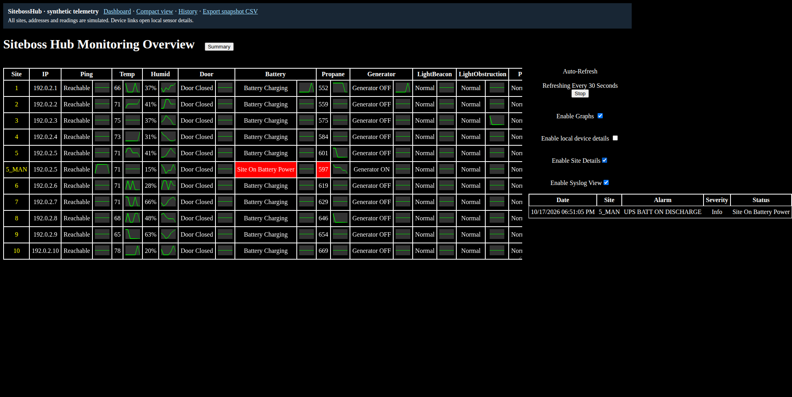
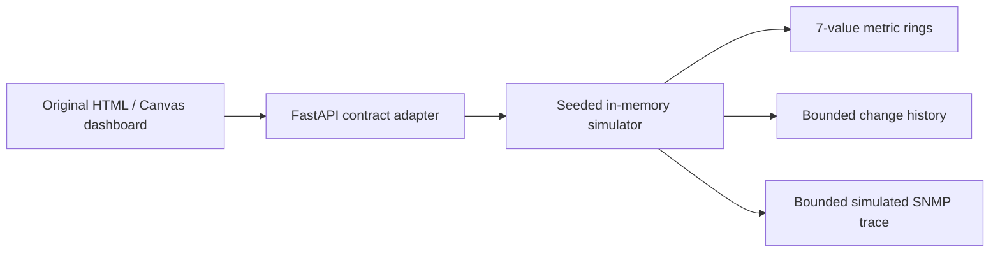

# SitebossHub

**A monitoring dashboard for distributed tower sensors, preserved as a runnable synthetic demo.**

SitebossHub brings temperature, humidity, power, propane, door, reachability and tower-light status into one operator view. It combines a summary table, hand-built Canvas sparklines, sensor drill-down, change history and generator-run information. All data in this repository is generated in memory; no tower, SNMP agent, account or private database is required.

The original system was written by Derek Poe in PowerShell and browser JavaScript. This repository keeps the original dashboard design and API contracts, with a Python/FastAPI simulator that makes the work easy to run and inspect. The simulator is a portfolio reconstruction, not the original production backend.



## Run locally

Python 3.11 or newer:

```sh
python -m venv .venv
# Windows PowerShell: .\.venv\Scripts\Activate.ps1
# Linux/macOS: source .venv/bin/activate
python -m pip install -e '.[dev]'
python -m sbh_demo
```

Open **http://127.0.0.1:9747**. Windows users can also run `./run.ps1`.

Try **Enable Graphs**, **Enable Site Details**, and **Enable Syslog View**. Click a site to see its simulated sensor polls; switch Summary to the generator-run table. The navigation bar links to history and a downloadable CSV snapshot. The local device-link option also opens simulated details, never an address on another network.

## Engineering story

The original PowerShell implementation separates several concerns:

- **Collection:** an SNMP poller resolves sensor values using primary and fallback OID layouts, then exposes a consistent site snapshot.
- **State and history:** current values, short rolling windows and recorded changes support different operator questions without making the browser understand device protocols.
- **Presentation:** the JavaScript UI preserves column order and legacy field names, distinguishes boolean alarms from numeric metrics, and draws sparklines and history graphs directly on Canvas.
- **Operations:** sensor drill-down and generator/propane views connect a fleet summary to the underlying readings. The original Excel reporting pipeline is separate; this demo provides a CSV snapshot instead.

The interesting boundary is the contract between collectors and the dashboard: a replacement backend can keep the operator workflow intact. The demo exercises that boundary with synthetic snapshots, bounded histories and an inspectable record of the SNMP calls that a real collector would make.

The [collector case study](docs/collector-case-study.md) traces the original polling cycle, value-change handling, operator workflow, and the evidence behind those descriptions.



Requests advance the simulator in two-second ticks. A lock keeps each state update and returned snapshot atomic across server threads. History stores at most 5,000 changes per site/metric; SNMP traces use a configurable bounded deque. Idle catch-up is capped at 300 ticks so the first request after a long pause cannot replay days of work. Random seeds and injected clocks make behavior reproducible in tests; wall-clock timestamps in normal runs still vary.

## API and configuration

`/demo` is a public route namespace, not an API key or authentication mechanism. Interactive API documentation is at `/docs`.

| Route | Purpose |
| --- | --- |
| `/demo/all` | Current sensor rows |
| `/demo/histAll` | Seven values per metric, aligned with the current site order |
| `/demo/hist/1,temp` | One site's rolling metric history |
| `/demo/hist2/1,temp,2026-10-17,23:59:00,25` | Up to 25 changes at or before a local timestamp |
| `/demo/pollSite/1` | Simulated poll values and poll times |
| `/demo/sysGet` | Current synthetic alarms |
| `/demo/genRunsGet` | Legacy JSON + `<~~~~~>` + timestamp payload |
| `/demo/report` | Downloadable synthetic snapshot CSV |
| `/debug/snmp_calls` | Primary/fallback OIDs and returned values; no network calls |
| `/healthz` | Process health response |

| Environment variable | Default | Meaning |
| --- | --- | --- |
| `SBH_DEMO_PORT` | `9747` | Local HTTP port |
| `SBH_DEMO_HOST` | `127.0.0.1` | Bind address |
| `SBH_DEMO_SITE_COUNT` | `10` | Numeric sites, from 1 to 200 |
| `SBH_DEMO_INCLUDE_MAN_SITE` | `true` | Include `5_MAN` to exercise the legacy special-case display |
| `SBH_DEMO_SEED` | `1337` | Simulation random seed |
| `SBH_DEMO_SNMP_CALL_LOG_SIZE` | `2000` | Retained simulated polls, from 1 to 10,000 |

Displayed addresses use the documentation-only `192.0.2.0/24` range. Unknown site requests return 404 and cannot create additional state. All state resets on restart. Use one server process: multiple workers would each own an independent simulation. There is no durable collector, real device polling, authentication or production deployment configuration in this package.

## Verify and build

```sh
python -m pytest
python -m build
```

The HTML and SVG assets ship inside the wheel, so an installed package can serve the interface outside the source checkout. Contract tests cover legacy response shapes, deterministic transitions, bounded history/logs, invalid requests, concurrent polling and CSV export.

For browser verification, leave the server running and use another terminal:

```sh
python -m pip install -e '.[browser]'
python -m playwright install chromium
python tools/browser_smoke.py
```

On Linux, Playwright may also require `python -m playwright install-deps chromium`. The smoke test exercises both dashboards, graphs, sensor details, generator runs, downloads and empty history, and fails on JavaScript errors, HTTP errors or external requests. CI runs the Python suite, builds and installs a wheel, and runs the browser check.

## Source and scope

The starting point was an existing portable SitebossHub demo and the author's original dashboard code. Packaging replaces the inherited route token and device links, fixes empty-data handling, validates requests/configuration, adds synchronization and bounded catch-up, packages assets and adds contract/browser checks. Environment-specific PowerShell collectors and operational datasets are not bundled here; the architectural description above is grounded in those original implementations. No scale, uptime or throughput claims are made from this simulation.

MIT licensed. Copyright © 2026 Derek Poe.
